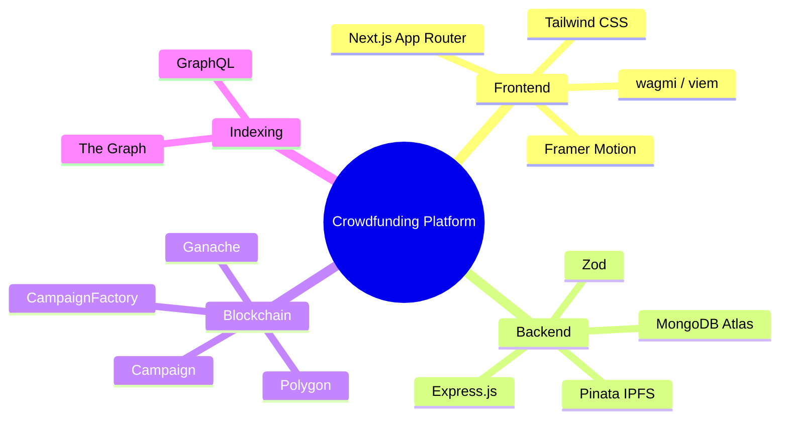

# Crowdfunding Platform Project

Production-oriented Web3 milestone-based crowdfunding platform built for the Polygon ecosystem.

This repository combines a smart-contract escrow layer, a Node.js API cache, and a modern Next.js frontend to support transparent fundraising with milestone-based fund release, proof uploads, governance voting, and decentralized storage integration.

## Overview

The platform is designed to reduce the risk of upfront fund misappropriation by locking campaign capital in on-chain escrow and releasing funds only when milestone proofs are submitted and approved through donor governance.

The architecture is split into four layers:

- Frontend: Next.js, React, Tailwind CSS, wagmi, viem, and Framer Motion.
- Backend: Node.js, Express.js, MongoDB Atlas, Zod, and Pinata IPFS integration.
- Blockchain: Solidity smart contracts deployed through Hardhat to Polygon and Ganache for local testing.
- Indexing: The Graph for fast event-driven reads and historical campaign state.

## Core Features

- Milestone-based escrow with tranche release.
- Donor contribution tracking and refund flow.
- Campaign proof uploads pinned to IPFS.
- Snapshot-style milestone governance support.
- Wallet connection and SIWE-friendly frontend foundation.
- Cached campaign metadata for fast UI rendering.
- Ganache-backed local blockchain testing workflow.

## Technology Stack

### Frontend

- Next.js 15 App Router
- React 19
- TypeScript
- Tailwind CSS
- wagmi + viem
- Apollo Client
- Framer Motion
- react-hot-toast
<p align="left">
	<strong>Polygon-based milestone crowdfunding with escrow, governance, proof uploads, and Graph-indexed transparency.</strong>
</p>

This repository implements a production-oriented Web3 crowdfunding SaaS designed to reduce upfront fraud risk by holding funds in smart-contract escrow and releasing capital only after milestone proofs and donor approval.

It combines a premium Next.js frontend, a Node.js cache API, and Solidity contracts deployed through Hardhat. Ganache is the default local blockchain environment for fast iteration and reproducible testing.

### Backend
- Milestone-based escrow with tranche release.
- Donor voting and approval flow.
- Proof-of-work uploads stored on IPFS.
- Creator and donor wallet interactions through SIWE-friendly plumbing.
- Cached metadata for low-latency UI responses.
- Ganache-powered local testing for rapid contract iteration.
- Polygon mainnet and Amoy support for public deployment paths.

- Node.js
- Express.js
- MongoDB + Mongoose
- Zod validation
- Pinata SDK for IPFS uploads

### Blockchain

- Hardhat

## Project Highlights

### Non-Custodial Escrow

Campaign capital stays locked in the contract until milestone conditions are met. The contract architecture favors explicit state transitions and avoids push-based payout loops.

### Trust and Identity

- Donors and voters: World ID + Gitcoin Passport
- Creators: Sumsub or Stripe Identity
- Medical / hospital flows: optional hardcoded treasury routing

### Security Model

- Checks-Effects-Interactions before transfers.
- Reentrancy protection on fund-moving paths.
- Snapshot-style voting to reduce flash-loan manipulation.
- Pull-based refunds for safer user claims.
- Custom errors for lower gas usage.

- Solidity ^0.8.20
- Ganache for local testing
### Prerequisites

- Node.js 24.18 or compatible Node 24 runtime
- npm
- Ganache UI or Ganache CLI
- MetaMask


## Repository Structure

```text
/
├── ARCHITECTURE_STATE.md
├── GANACHE_RUNBOOK.md
├── backend/
├── blockchain/
└── frontend/
```


### Configure Environment Variables

Copy the example files and provide your credentials:

- `backend/.env.example`
- `frontend/.env.example`

Common values include:

- MongoDB Atlas URI
- Pinata API keys
- Alchemy RPC URL
- Clerk public key
- Graph endpoint
- Private wallet key for deployment scripts

## Getting Started

### 1. Prerequisites

- Node.js 24.18 or compatible Node 24 runtime
- npm

Frontend:

```bash
cd frontend
npm run dev
```

Blockchain tests on Ganache:

```bash
cd blockchain
npm test
```

- Ganache UI or Ganache CLI for local chain testing
- MetaMask for wallet testing


## Architecture Notes



The canonical system design, security matrix, and endpoint layout are documented in [ARCHITECTURE_STATE.md](./ARCHITECTURE_STATE.md).

```bash
cd blockchain


- Build the campaign feed and campaign detail experience.
- Add the Glass Escrow Card, Milestone Tracker, and DAO Voting Widget.
- Expand contract test coverage for milestone approvals and refunds.
- Add deployment automation for Polygon and Amoy.

cd ../frontend
npm install
```

### 3. Configure Environment Variables

Copy the example files and fill in your values:

- `backend/.env.example`
- `frontend/.env.example`

Typical values include MongoDB Atlas credentials, Pinata keys, Alchemy RPC URLs, Clerk settings, and frontend Graph endpoints.

### 4. Run the Stack

Backend:

```bash
cd backend
npm run dev
```

Frontend:

```bash
cd frontend
npm run dev
```

Blockchain tests with Ganache:

```bash
cd blockchain
npm test
```

## Local Blockchain Testing

Ganache is the default local testing network for this project.

See the full runbook in [GANACHE_RUNBOOK.md](./GANACHE_RUNBOOK.md) for:

- Ganache UI and CLI startup steps
- MetaMask local network setup
- Deployment to Ganache
- Running contract tests on the Ganache network

## Architecture Notes

- Smart contracts hold the authoritative escrow state.
- MongoDB is used for mutable metadata and cached application state.
- IPFS stores milestone proofs and other immutable artifacts.
- The Graph provides query performance for UI reads and campaign history.

For the canonical architecture decisions and security model, see [ARCHITECTURE_STATE.md](./ARCHITECTURE_STATE.md).

## Security Principles

- Use Checks-Effects-Interactions before external transfers.
- Protect fund-moving code with reentrancy safeguards.
- Prefer pull-based refunds over push-based loops.
- Keep secrets in environment variables and out of source control.
- Separate on-chain execution from off-chain cache and rendering logic.

## Project Status

The repository currently contains:

- A Hardhat blockchain workspace.
- An Express/Mongoose backend cache API.
- A Next.js App Router frontend foundation.
- A Ganache local testing runbook.

## License

No license has been specified yet.